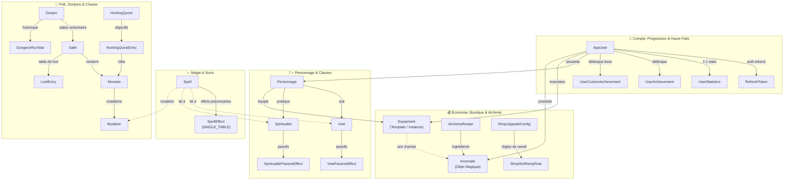
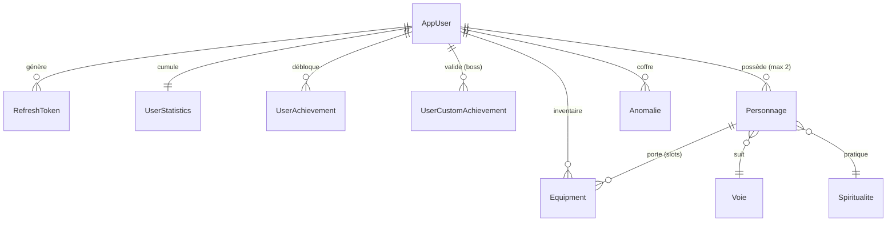
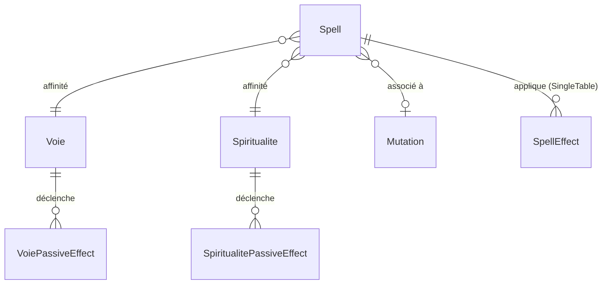
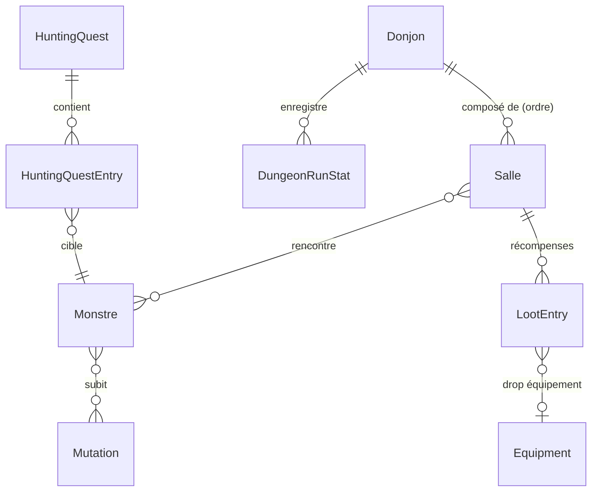
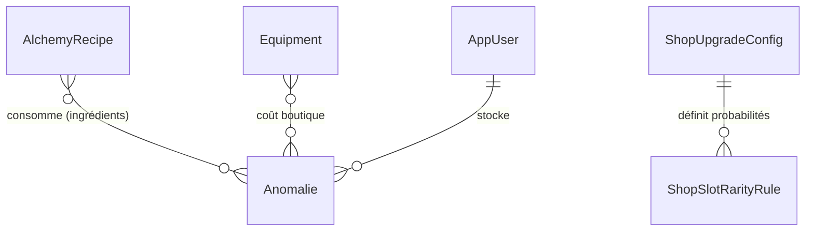

# 🏰 Grimoire — Architecture & Documentation Technique

## Vue d'ensemble

**Grimoire** est un jeu de rôle/RPG web monolithique construit sur **Spring Boot 3.4.4** / **Java 21**, couplé à une **SPA React 19 + TypeScript** (compilée via **Vite 6** dans `/static/app/` et servie directement par Spring Boot) ainsi qu'à des moteurs ES6+/Canvas dédiés. Le backend gère l'intégralité de la logique métier (philosophie **SSOT** — *Single Source of Truth*) : authentification, gestion des personnages, système de combat PvE solo et multijoueur en temps réel, donjons procéduraux/scriptés, tutoriel guidé, tableau de chasse, hauts faits & titres, secrets musicaux, alchimie, boutique évolutive, et éditeur de sorts complet.

> [!NOTE]
> Package racine : `generation.grimoire` — groupId Maven `generation`, artifactId `grimoire`.  
> Le suivi détaillé de la migration SPA est documenté dans [`MIGRATION_REACT.md`](MIGRATION_REACT.md).

---

## Stack technique

| Composant | Technologie | Version |
|---|---|---|
| Runtime Backend | Java | 21 |
| Framework Backend | Spring Boot | 3.4.4 |
| ORM | Hibernate / JPA | (via `spring-boot-starter-data-jpa`) |
| BDD | MySQL | 8.0 |
| Sécurité | Spring Security + JWT (`jjwt`) | 0.11.5 |
| Mapping | MapStruct + Mappers Spring | 1.6.3 |
| Sérialisation | Jackson + `jackson-datatype-hibernate6` | — |
| Boilerplate | Lombok | 1.18.36 |
| Frontend SPA | React + TypeScript + React Router | React 19.0 · TS 5.7 · Router 7.1 |
| Bundler & Dev Server | Vite | 6.1.0 |
| Moteurs & Rendu UI | Modules ES6+ / CSS3 (Design System) / HTML5 Canvas | — |
| Build | Maven (wrapper) + npm (`frontend/`) | — |
| Conteneurisation & Cloud | Docker, Docker Compose, AWS ECR & AWS Lambda (Web Adapter) | — |

### Choix architecturaux notables

- **Monolithe pur & SSOT** — pas de microservices, tout est embarqué dans un seul JAR en production. Le backend détient 100 % des formules, validations et règles métier ; le frontend est une couche de présentation pure (zéro style inline, classes CSS sémantiques).
- **SPA React 19 intégrée à Spring Boot** — les 16 pages applicatives sont migrées dans `frontend/` (`React 19`, `TypeScript`, `React Router 7`). En production, le bundle Vite est généré dans `src/main/resources/static/app/` (`base: '/app/'`) et servi par Spring Boot via `WebMvcConfig` (`forward:/app/index.html`) sur des URLs propres sans `.html` (`/grimoire`, `/armory`, `/dungeons`, `/combat`, etc.). Les anciens fichiers `*.html` redirigent automatiquement vers ces nouvelles routes.
- **Sessions de combat in-memory** (`ConcurrentHashMap`) — pas de persistance des combats actifs en BDD, diffusion temps réel via **SSE** (*Server-Sent Events*).
- **`ddl-auto=update`** — le schéma BDD évolue avec les entités.
- **Caching & Compression** — `@EnableCaching` sur les recettes d'alchimie, cache HTTP sur les ressources statiques (`max-age=3600`), compression Gzip activée.
- **Scheduling activé** (`@EnableScheduling`) — timeout automatique des combats inactifs et rotation quotidienne/hebdomadaire des quêtes de chasse.

---

## Structure des packages Backend

```text
generation.grimoire/
├── GrimoireApplication.java          ← Point d'entrée (@EnableScheduling, @EnableCaching)
├── TestRunner.java                   ← CommandLineRunner (profil "dev" uniquement)
│
├── config/                           ← Configuration Spring & Routage SPA
│   ├── WebMvcConfig.java             ← Enregistrement du CombatInterceptor + forward des 16 routes SPA vers /app/index.html
│   ├── CombatInterceptor.java        ← Bloque les actions hors-combat si le joueur est en combat (/combat, /app/** exclus)
│   └── JacksonConfig.java            ← Module Hibernate6 pour gérer les lazy proxies
│
├── security/                         ← Authentification & autorisation
│   ├── SecurityConfig.java           ← Chaîne de filtres, routes SPA publiques, RBAC (USER/ADMIN), stateless
│   ├── JwtService.java               ← Génération/validation JWT (HS256, 15min)
│   ├── JwtAuthenticationFilter.java  ← Filtre HTTP extrayant le JWT du header
│   ├── RefreshTokenService.java      ← Gestion des refresh tokens persistés en BDD
│   └── UserDetailsServiceImpl.java   ← Bridge vers Spring Security
│
├── controller/                       ← REST API (16 contrôleurs)
│   ├── auth/
│   │   └── AuthController.java       ← Login, register, refresh token
│   ├── pve/
│   │   ├── CombatController.java     ← Actions de combat (cast, flee, next-room, signaux/pings, SSE)
│   │   ├── DungeonController.java    ← Liste/détail des donjons et sources de drop
│   │   ├── DungeonStatController.java← Statistiques globales et personnelles des donjons
│   │   ├── HuntingQuestController.java ← Quêtes de chasse (quotidiennes/hebdomadaires)
│   │   ├── MultiCombatController.java← Lobbies multi-joueurs (créer, rejoindre, SSE)
│   │   ├── PvEAdminController.java   ← CRUD admin donjons/monstres/mutations
│   │   ├── SecretController.java     ← Validation et récompenses des secrets par palier
│   │   └── TestMonstreController.java← Endpoint de test pour les monstres
│   ├── AchievementController.java    ← Hauts faits, titres actifs et notifications
│   ├── PersonnageController.java     ← CRUD personnages, équipement, spiritualité
│   ├── EquipmentController.java      ← Templates, boutique, inventaire
│   ├── ShopController.java           ← Boutique évolutive (achat/vente, amélioration, config admin)
│   ├── WebSpellCreationController.java ← Éditeur de sorts (CRUD complet avec effets)
│   ├── AlchemyController.java        ← Recettes et crafting
│   ├── AnomalieController.java       ← CRUD anomalies (objets magiques)
│   ├── EnumMetaController.java       ← Exposition des métadonnées d'enums au frontend (/api/meta/all)
│   └── DebugController.java          ← Endpoint de debug (dev)
│
├── service/                          ← Logique métier (19 services)
│   ├── pve/
│   │   ├── CombatService.java        ← Service de façade pour le combat
│   │   ├── CombatRoomService.java    ← Gestion des salles, portes étranges, autels, loots et progression
│   │   ├── CombatTurnService.java    ← Moteur de tours, initiative, canalisation et statuts
│   │   ├── CombatActionService.java  ← Résolution des actions de combat (fuite, objets, signaux)
│   │   ├── CombatLogCapture.java     ← Capture structurée des logs de combat par action/tour
│   │   ├── CombatEventEmitter.java   ← SSE (Server-Sent Events) pour le temps réel
│   │   ├── DungeonLootTrackerService.java ← Suivi et agrégation des loots obtenus en donjon
│   │   ├── DungeonTutorialService.java    ← Logique du donjon tutoriel guidé
│   │   ├── HuntingQuestService.java  ← Génération, progression et réclamation des quêtes de chasse
│   │   ├── MultiCombatService.java   ← Lobbies multi-joueurs + synchronisation
│   │   ├── PvEAdminService.java      ← Opérations CRUD admin PvE
│   │   └── SpellAvailabilityService.java  ← Évaluation de la disponibilité des sorts (coûts, CD, conditions)
│   ├── AchievementService.java       ← Déblocage des hauts faits (standards & boss), stats et titres
│   ├── SpellService.java             ← Résolution et lancement des sorts
│   ├── PassiveDispatcher.java        ← Dispatch des événements aux passifs (mediator)
│   ├── AlchemyService.java           ← Crafting avec vérification d'ingrédients et limites
│   ├── DataInitializerService.java   ← Seed des Voies et Spiritualités au démarrage
│   ├── RenameCascadeService.java     ← Cascade de renommage (anomalies & équipements)
│   ├── PersonnageService.java        ← Accès et gestion des personnages
│   └── VoieService.java              ← Accès aux voies
│
├── entity/                           ← Entités JPA (modèle de données persisté)
│   ├── auth/
│   │   ├── AppUser.java              ← Utilisateur (rôle, or, secrets, titre actif, niveau boutique)
│   │   └── RefreshToken.java         ← Token de rafraîchissement
│   ├── achievement/
│   │   ├── UserAchievement.java      ← Haut fait débloqué par un joueur
│   │   ├── UserCustomAchievement.java← Haut fait personnalisé (lié aux salles de boss)
│   │   └── UserStatistics.java       ← Compteurs statistiques du joueur
│   ├── personnage/
│   │   ├── Personnage.java           ← Entité centrale du héros
│   │   ├── PersonnageCombatHelper.java ← Logique de combat et stats extraite
│   │   └── ActiveShield.java         ← Bouclier actif en combat
│   ├── pve/
│   │   ├── Donjon.java               ← Donjon (salles ordonnées, secret requis, tutoriel)
│   │   ├── Salle.java                ← Salle (combat, trésor, piège, événement, autel, boss...)
│   │   ├── Monstre.java              ← Template de monstre (stats, type, behavior, format boss)
│   │   ├── Mutation.java             ← Mutation applicable aux monstres
│   │   ├── LootEntry.java            ← Table de loot (probabilité + récompense)
│   │   ├── DungeonRunStat.java       ← Historique statistique d'une run de donjon
│   │   ├── HuntingQuest.java         ← Quête de chasse active (quotidienne/hebdomadaire)
│   │   └── HuntingQuestEntry.java    ← Objectif de monstre au sein d'une quête de chasse
│   ├── spell/type/effect/            ← 20 sous-types concrets de SpellEffect (SINGLE_TABLE)
│   ├── voie/passif/                  ← Passifs de Voie (8 implémentations spécifiques)
│   ├── spiritualite/passif/          ← Passifs de Spiritualité (3 implémentations)
│   ├── Spell.java                    ← Sort (coûts, type de cast, effets)
│   ├── SpellEffect.java              ← Classe abstraite racine des effets (SINGLE_TABLE)
│   ├── Equipment.java                ← Équipement / consommable (template ou instance)
│   ├── Anomalie.java                 ← Objet magique (monnaie alternative / ingrédient)
│   ├── AlchemyRecipe.java            ← Recette d'alchimie
│   ├── ShopUpgradeConfig.java        ← Configuration des paliers d'amélioration de la boutique
│   ├── ShopSlotRarityRule.java       ← Règles de probabilités de rareté par slot de boutique
│   ├── Voie.java                     ← Voie (classe de personnage)
│   └── Spiritualite.java             ← Spiritualité (sous-classe thématique)
│
├── model/pve/                        ← Objets transients (non persistés en BDD)
│   ├── CombatSession.java            ← État complet d'un combat en cours (solo ou duo, validations co-op)
│   ├── MultiCombatSession.java       ← État d'un lobby multi-joueurs
│   ├── ActiveMonster.java            ← Instance vivante d'un monstre en combat
│   ├── InitiativeEntry.java          ← Entrée dans l'ordre d'initiative
│   ├── SpellAvailability.java        ← Disponibilité d'un sort (grisage frontend)
│   ├── Challenge.java                ← Défi de combat optionnel en salle de donjon
│   └── RoomInteractionChoice.java    ← Choix interactif de salle (autel, porte étrange, événement)
│
├── dto/                              ← Data Transfer Objects (26 DTOs : records & classes)
│   ├── achievement/                  ← AchievementDTO, SetTitleRequestDTO, UserAchievementsResponseDTO
│   ├── alchemy/                      ← AlchemyRecipeRequestDTO, CraftRequestDTO
│   ├── equipment/                    ← DungeonDropSourceDTO, EquipmentRequestDTO, EquipmentResponseDTO, EquipmentShopDTO
│   ├── personnage/                   ← PersonnageRequestDTO, PersonnageResponseDTO, PersonnageSummaryDTO
│   ├── pve/                          ← DonjonDTO, DonjonSummaryDTO, LobbyInfoDTO, HostHeroInfoDTO, CombatSignalDTO,
│   │                                   CombatSignalRequest, CombatSignalsConfigDTO, DungeonStatsResponse,
│   │                                   DungeonGlobalStatDto, DungeonRunStatDto, SpellCostModifierDTO,
│   │                                   SpellEffectPreviewDTO, SpellTargetPreviewDTO
│   ├── shop/                         ← ShopStatusDTO
│   └── spell/                        ← SpellCreationRequestDTO
│
├── mapper/                           ← Conversion Entité ↔ DTO (MapStruct & Spring)
│   ├── PersonnageMapper.java
│   ├── EquipmentMapper.java
│   ├── SpellMapper.java
│   └── AlchemyRecipeMapper.java
│
├── enumeration/                      ← 27 enums de domaine (exposés via @JsonFormat / EnumMetaController)
│   ├── StatType, DamageType, EffectTarget, Source
│   ├── SpellCategory, SpellCastingType
│   ├── EquipmentSlot, EquipmentRarity, EquipmentEffectType
│   ├── MonsterType, MonsterBehavior, RoomType, EventSubType, TrapEffectType, TutorialStep
│   ├── AnomalieCategory, ConsumableCategory, SpiritualiteType
│   ├── VoieType, KarmaAlignment, DetachedSoulRequirement, RecipeRewardType
│   ├── AchievementCategory, AchievementType, DungeonOutcome
│   └── CombatSignalType, CombatSignalAction
│
├── event/                            ← Événements de gameplay (pattern Observer)
│   ├── GameEvent.java                ← Interface de base
│   ├── TurnStartEvent.java
│   ├── SpellCastEvent.java
│   ├── SpellChannelingTickEvent.java ← Tick de sort canalisé
│   ├── SpellCostAdjustEvent.java
│   ├── SpellCostPaidEvent.java
│   ├── CanCastCheckEvent.java
│   └── CastingTypeAdjustEvent.java
│
├── passif/
│   └── PassiveEffect.java            ← Interface unifiée pour tous les passifs
│
├── exception/
│   └── GlobalExceptionHandler.java   ← @ControllerAdvice, JSON structuré
│
├── scheduler/
│   ├── CombatTimeoutScheduler.java   ← Auto-flee des combats inactifs (10min)
│   └── HuntingQuestScheduler.java    ← Rotation automatique des quêtes de chasse
│
├── repository/                       ← 21 Spring Data JPA repositories
│   ├── auth/ (UserRepository, RefreshTokenRepository)
│   ├── pve/ (Donjon, Salle, Monstre, Mutation, LootEntry, DungeonRunStat, HuntingQuest, HuntingQuestEntry)
│   ├── Personnage, Spell, Equipment, Anomalie, Spiritualite, Voie, AlchemyRecipe, ShopUpgradeConfig
│   └── UserAchievement, UserCustomAchievement, UserStatistics
│
└── utils/
    └── StatCalculator.java           ← Résolution des sources de stats (switch exhaustif)
```

---

## Architecture Frontend (`frontend/` & `src/main/resources/static/`)

Suite à la migration vers **React 19 + TypeScript + Vite 6**, l'architecture frontend s'articule autour de deux répertoires complémentaires :

### 1. Application SPA React (`frontend/`)

```text
frontend/
├── index.html                        ← Point d'entrée HTML de la SPA (monte #root)
├── package.json                      ← Dépendances (React 19, React Router 7, Vite 6, TypeScript 5.7)
├── vite.config.ts                    ← Build vers ../src/main/resources/static/app (base: '/app/') + proxy dev (:5173 → :8080)
├── tsconfig.json                     ← Configuration TypeScript stricte
└── src/
    ├── main.tsx                      ← Bootstrap React 19 (createRoot)
    ├── App.tsx                       ← Routeur BrowserRouter (16 routes SPA + redirections .html + SpaLinkInterceptor)
    ├── services/
    │   └── api.ts                    ← Client HTTP TypeScript centralisé (JWT, auto-refresh, helpers d'auth)
    ├── types/
    │   ├── auth.ts                   ← Interfaces et DTOs d'authentification/utilisateur
    │   └── custom-elements.d.ts      ← Déclarations JSX pour les Web Components (<app-navbar>, <app-modal>, <app-loader>)
    └── pages/                        ← 16 pages applicatives migrées en React + TypeScript :
        ├── GrimoirePage.tsx          ← (/grimoire) Grimoire de sorts, filtres multi-critères, animations Lvl-5 & Forge admin
        ├── ArmoryPage.tsx            ← (/armory) Personnages, équipement, toile radar Canvas, spiritualité & tutoriel
        ├── DungeonsPage.tsx          ← (/dungeons) Sélection d'équipe, cartes de donjons, sacoche, lobbies multijoueurs SSE
        ├── CombatPage.tsx            ← (/combat) Arène PvE solo/multi temps réel (SSE, sprites, signaux/pings, choix co-op)
        ├── VaultPage.tsx             ← (/vault) Coffre de compte (équipements, consommables, anomalies, CRUD admin)
        ├── ShopPage.tsx              ← (/shop) Boutique évolutive, promos dynamiques, marché noir, amélioration de palier
        ├── AlchemyPage.tsx           ← (/alchemy) Grimoire de recettes, chaudron de transmutation & particules
        ├── HuntingPage.tsx           ← (/hunting) Tableau de chasse (quêtes quotidiennes/hebdomadaires, classements)
        ├── SecretsPage.tsx           ← (/secrets) Secrets à 3 paliers, lecteur audio thématique & récompenses d'or
        ├── DungeonStatsPage.tsx      ← (/dungeon-stats) KPIs, graphiques Chart.js, historique des runs & reset tutoriels
        ├── AchievementsPage.tsx      ← (/achievements) Hauts faits, progression globale, statistiques & sélection de titre
        ├── ShopAdminPage.tsx         ← (/shop-admin) Administration des modèles de boutique, coûts en anomalies & paliers
        ├── PveAdminPage.tsx          ← (/pve-admin) Administration des monstres, mutations, donjons, salles & hauts faits boss
        ├── AlchemyAdminPage.tsx      ← (/alchemy-admin) Administration des recettes et ingrédients d'alchimie
        ├── LoginPage.tsx             ← (/login) Connexion & reprise automatique de combat actif
        └── RegisterPage.tsx          ← (/register) Inscription avec validation et connexion automatique
```

### 2. Assets statiques, Bundle de production & Modules JS/CSS (`src/main/resources/static/`)

```text
static/
├── app/                              ← Bundle de production généré par Vite (`npm --prefix frontend run build`)
│   ├── index.html                    ← Coquille HTML servie par Spring Boot sur toutes les routes SPA
│   └── assets/                       ← Bundles JS/CSS minifiés et hashés
│
├── *.html                            ← 16 fichiers HTML de compatibilité redirigeant vers les routes SPA sans .html
│
├── styles/                           ← Architecture CSS modulaire (Design System RPG — zéro style inline)
│   ├── variables.css                 ← Tokens de design (couleurs, typographie Cinzel/Inter, espacements)
│   ├── ui/                           ← Composants réutilisables (components, layout, forms, utilities, equipment, tutorial...)
│   ├── pages/                        ← 17 feuilles de style spécifiques par domaine/page (dont spell-cards.css)
│   └── sprites/ & sprite/            ← Animations CSS (spell-cards-animations.css, fox.css, blacksmith.css, agis.css)
│       └── <voie>/                   ← Spritesheets des 8 Voies + sous-dossiers esprit/, karma/, tenebre/
│
├── js/                               ← Modules ES6+ & moteurs interactifs (pilotés par les pages React)
│   ├── app.js & ui.js                ← Pont d'initialisation et notifications/helpers d'interface
│   ├── services/                     ← api.js, auth.js (partagés avec les modules ES6)
│   ├── utils/                        ← constants.js (/api/meta/all), filters.js (classes .affinity-*), state.js, utils.js
│   ├── components/                   ← Web Components (<app-navbar>, <app-modal>, <app-loader>), animations.js, particles.js, tutorial.js
│   ├── combat/                       ← Moteur client de combat (init, state, socket SSE, actions, spells, ui, signals, sprites, utils)
│   ├── admin/                        ← Modules d'administration PvE (dungeons, monsters, mutations, items, state, utils)
│   └── pages/                        ← Contrôleurs métier et rendu Canvas (hero-spider.js, forge.js, grimoire.js, combat...)
│
├── images/                           ← Avatars des 8 Voies, sprites du forgeron, familier renard, Agis...
└── sons/                             ← 38 pistes audio MP3 (ambiances donjon & thèmes des 11 secrets sur 3 niveaux)
```

---

## Modèle de données (relations clés)

### 1. Cartographie globale par domaines



---

### 2. Schémas relationnels ciblés (par sous-système)

#### A. Joueur, Personnage, Équipement & Hauts Faits


#### B. Sorts, Voies & Passifs


#### C. Donjons, Monstres, Chasse & Statistiques


#### D. Alchimie & Boutique Évolutive


---

## Choix architecturaux détaillés

### 1. Routage SPA & Intégration React / Spring Boot

- **Navigation SPA instantanée** : [`App.tsx`](frontend/src/App.tsx) déclare les 16 routes applicatives sous `BrowserRouter` et inclut un `SpaLinkInterceptor` qui intercepte les clics sur les liens internes (y compris depuis le Web Component `<app-navbar>`) pour naviguer sans rechargement de page.
- **Forwarding Serveur** : [`WebMvcConfig`](src/main/java/generation/grimoire/config/WebMvcConfig.java) redirige `/` vers `/grimoire` et associe chaque route SPA (`/grimoire`, `/armory`, `/dungeons`, `/combat`, etc.) à `forward:/app/index.html`.
- **Rétrocompatibilité des URLs** : Les anciennes adresses en `*.html` sont interceptées à la fois côté client (`<RedirectWithSearch />` dans `App.tsx`) et côté statique pour rediriger proprement vers les routes sans extension tout en conservant les query params (`?sessionId=...`, etc.).
- **Zéro style inline & Classes d'affinité** : Conformément aux règles SSOT du projet, la visibilité est pilotée par `.is-hidden` / `.init-hidden` et les couleurs de voies, spiritualités et niveaux de sorts passent par des classes sémantiques (`.affinity-*`, `.lvl-badge-*`).

### 2. Système de sorts — Héritage SINGLE_TABLE

Le système de sorts utilise le pattern **Single Table Inheritance** de JPA :

- [`SpellEffect`](src/main/java/generation/grimoire/entity/SpellEffect.java) est la classe abstraite racine avec un `@DiscriminatorColumn("effect_type")`.
- **20 sous-types concrets** implémentent chacun leur propre méthode `apply(caster, target)` :

| Catégorie | Effets |
|---|---|
| **Dégâts** | `DamageEffect`, `DamageFixedEffect`, `DamagePercentageEffect`, `DamageOverTimeEffect` |
| **Soin** | `HealEffect`, `HealFixedEffect`, `HealPercentageEffect`, `HealOverTimeEffect` |
| **Mana** | `ManaEffect`, `ManaFixedEffect`, `ManaPercentageEffect`, `ManaOverTimeEffect` |
| **Chaleur** | `HeatFixedEffect`, `HeatPercentageEffect`, `HeatOverTimeEffect` |
| **Buff/Debuff** | `BuffDebuffEffect` |
| **Utilitaires** | `ShieldEffect`, `DispelEffect`, `PurgeEffect`, `BudEffect` |

**Pourquoi SINGLE_TABLE ?** Performance (pas de JOIN pour charger les effets d'un sort), simplicité des requêtes polymorphiques, et la table reste lisible car les sous-types partagent beaucoup de colonnes.

### 3. Système de passifs — Event-Driven avec Mediator

Architecture basée sur le pattern **Observer/Mediator** :

```text
GameEvent → PassiveDispatcher → [PassiveEffect₁, PassiveEffect₂, ...]
```

- [`PassiveEffect`](src/main/java/generation/grimoire/passif/PassiveEffect.java) — interface unifiée (toutes sources : Voie, Spiritualité...)
- [`PassiveDispatcher`](src/main/java/generation/grimoire/service/PassiveDispatcher.java) — collecte dynamiquement les passifs du personnage, les trie par priorité, et dispatch les événements.
- **7 types d'événements concrets** (implémentant [`GameEvent`](src/main/java/generation/grimoire/event/GameEvent.java)) : `TurnStartEvent`, `SpellCastEvent`, `SpellChannelingTickEvent`, `SpellCostAdjustEvent`, `SpellCostPaidEvent`, `CanCastCheckEvent`, `CastingTypeAdjustEvent`.
- **8 passifs de Voie** (Raison, Sûreté, Trahison, Consolidation, Conviction, Création, Destruction, Violence).
- **3 passifs de Spiritualité** (Esprit, Karma, Ténèbres).

**Pourquoi ?** Découplage total entre le moteur de combat et les effets passifs. Ajouter une nouvelle Voie = créer une classe, aucune modification du `CombatService`.

### 4. Combat — Sessions in-memory, SSE, Sprites dynamiques & Signaux

- Les combats sont stockés dans une `ConcurrentHashMap<String, CombatSession>` dans [`CombatService`](src/main/java/generation/grimoire/service/pve/CombatService.java), qui délègue aux sous-services spécialisés (`CombatRoomService`, `CombatTurnService`, `CombatActionService`, `SpellAvailabilityService`, `DungeonTutorialService`).
- Le temps réel utilise **Server-Sent Events (SSE)** via [`CombatEventEmitter`](src/main/java/generation/grimoire/service/pve/CombatEventEmitter.java) — chaque client reçoit les mises à jour de la session et les signaux tactiques via un `SseEmitter`.
- Un [`CombatTimeoutScheduler`](src/main/java/generation/grimoire/scheduler/CombatTimeoutScheduler.java) vérifie toutes les 60s et force la fuite des combats inactifs depuis plus de 10 minutes.
- [`CombatInterceptor`](src/main/java/generation/grimoire/config/CombatInterceptor.java) — `HandlerInterceptor` qui bloque toute action non-combat pour un joueur en plein combat (redirection vers `/combat` pour les pages, 403 pour les API).
- **Système de Sprites & Animations** : En combat et dans la forge, les animations et poses du héros s'adaptent dynamiquement à sa **Voie** (8 sets de poses complets) et à sa **Spiritualité** (overrides visuels pour *Esprit*, *Karma* et *Ténèbres*, gestion des sorts canalisés et animation de mort), complétés par les effets CSS des cartes de sorts de rang 5 (`spell-cards-animations.css`).

### 5. Multi-joueurs — Lobby, Synchronisation Co-op & Pings Tactiques

- [`MultiCombatService`](src/main/java/generation/grimoire/service/pve/MultiCombatService.java) gère un système de **lobbies** (code court 6 caractères).
- L'hôte crée un lobby → l'invité rejoint avec un code → une fois prêts, le lobby démarre un `CombatSession` partagé.
- **Validation Co-op synchronisée `(1/2)`** : Toutes les décisions de transition de salle en duo (avancer après victoire, ouvrir/ignorer un coffre, choisir une option d'événement/piège/autel/porte étrange, quitter le marchand) affichent la progression `(readyCount/totalCount)` et le choix de l'allié en temps réel via SSE (`playerReadyNextRoom` et `playerRoomChoices`).
- En combat coopératif, les joueurs peuvent échanger des **signaux tactiques (pings & emotes)** temps réel via SSE (avec option d'ignorer les pings).

### 6. Progression Transverse — Hauts Faits, Chasse, Secrets & Statistiques

- **Hauts Faits & Titres** ([`AchievementService`](src/main/java/generation/grimoire/service/AchievementService.java)) : Suivi automatique des statistiques joueur (`UserStatistics`), déblocage de hauts faits globaux et de hauts faits personnalisés sur les salles de boss (`UserCustomAchievement`), attribution de titres affichés en jeu et notifications temps réel.
- **Tableau de Chasse** ([`HuntingQuestService`](src/main/java/generation/grimoire/service/pve/HuntingQuestService.java) & [`HuntingQuestScheduler`](src/main/java/generation/grimoire/scheduler/HuntingQuestScheduler.java)) : Quêtes quotidiennes et hebdomadaires de chasse aux monstres avec récompenses.
- **Secrets** ([`SecretController`](src/main/java/generation/grimoire/controller/pve/SecretController.java)) : Déblocage de secrets à 3 paliers liés aux monstres/donjons, avec pistes musicales dédiées et récompenses en or.
- **Statistiques de Donjons** ([`DungeonStatController`](src/main/java/generation/grimoire/controller/pve/DungeonStatController.java)) : Enregistrement de chaque fin de donjon (`DungeonRunStat`) permettant d'analyser les taux de victoire/défaite et la popularité des Voies/Spiritualités.

### 7. Sécurité — JWT Stateless + RBAC

- Authentification **JWT HS256** avec access token (15 min) + refresh token (persisté en BDD).
- **2 rôles** : `USER` et `ADMIN`.
- Les routes SPA (`/grimoire`, `/armory`, etc.), les assets (`/app/**`, `/js/**`, `/styles/**`, `/images/**`, `/sons/**`) et les GET de consultation publique (`/api/**`, `/api/meta/**`) sont accessibles sans authentification au niveau HTTP (l'accès fonctionnel aux pages protégées est géré par la SPA et les appels API authentifiés).
- Les mutations (POST/PUT/DELETE) d'administration nécessitent le rôle `ADMIN`.
- Les actions joueur (cast, equip, craft, chasse, boutique) nécessitent une authentification valide.
- CSRF désactivé (API stateless).

### 8. Sérialisation & Performance Hibernate

- [`JacksonConfig`](src/main/java/generation/grimoire/config/JacksonConfig.java) enregistre le `Hibernate6Module` pour que les lazy proxies non-initialisés se sérialisent en `null` au lieu de lever une `LazyInitializationException`.
- Optimisation des requêtes et écritures dans `application.properties` :
  - `default_batch_fetch_size=32` pour réduire drastiquement les requêtes N+1.
  - Batching JDBC activé (`batch_size=30`, `order_inserts=true`, `order_updates=true`).

### 9. Initialisation des données — Seed au démarrage

[`DataInitializerService`](src/main/java/generation/grimoire/service/DataInitializerService.java) utilise `@EventListener(ApplicationReadyEvent.class)` pour créer/mettre à jour les 8 Voies et 3 Spiritualités au démarrage avec leurs descriptions, rangs et passifs associés.

### 10. Pattern Template/Instance & Boutique Évolutive

Les `Equipment` et `Anomalie` utilisent un flag `isTemplate` :
- **Template** = définition de référence créée par l'admin.
- **Instance** = copie possédée par un joueur, créée via `copyStatsFrom(template)`.
- La boutique ([`ShopController`](src/main/java/generation/grimoire/controller/ShopController.java)) propose des slots configurables par palier (`ShopUpgradeConfig`, `ShopSlotRarityRule`) que le joueur peut améliorer pour débloquer davantage d'emplacements et de meilleures probabilités de rareté.

### 11. Cascade de renommage

[`RenameCascadeService`](src/main/java/generation/grimoire/service/RenameCascadeService.java) propage automatiquement les renommages d'**anomalies** et d'**équipements/consommables** à travers toutes les tables qui les référencent par nom (recettes d'alchimie, coûts d'équipements, secrets requis de donjons, secrets natifs de monstres, tables de loot et salles).

---

## Développement Local & Synchronisation Frontend

### 1. Mode Développement avec HMR (Vite `:5173` + Spring Boot `:8080`)

```powershell
# Terminal 1 — Backend Spring Boot (:8080)
.\mvnw.cmd spring-boot:run

# Terminal 2 — Serveur de dev Vite (:5173 avec proxy vers :8080)
npm --prefix frontend run dev
```

### 2. Build de la SPA React vers Spring Boot (`:8080`)

Après toute modification dans `frontend/` ou dans `src/main/resources/static/`, compiler la SPA dans `src/main/resources/static/app/` et synchroniser les ressources Maven :

```powershell
npm --prefix frontend run build
.\mvnw.cmd resources:resources
```

---

## Points d'attention

> [!IMPORTANT]
> ### Risques & Points de vigilance
> - **Synchronisation du bundle `/static/app/`** : l'image Docker compilant uniquement le projet via Maven (`mvn clean package -DskipTests`), il est impératif d'exécuter `npm --prefix frontend run build` avant de commiter des changements effectués dans `frontend/` afin que `src/main/resources/static/app/` soit toujours à jour.
> - **Combats in-memory** : perte des sessions de combat actives en cas de redémarrage serveur.
> - **`ddl-auto=update`** : pratique pour faire évoluer le schéma rapidement, mais les suppressions de colonnes obsolètes nécessitent un nettoyage SQL explicite (voir `scripts/clean_unused_db_columns.sql`).
> - **Suite de tests (73 classes de test)** : couvre les contrôleurs, services PvE, effets de sorts, passifs, mappers et sécurité. Le build Docker ignore les tests (`-DskipTests`) pour accélérer l'image : exécuter `mvn test` avant tout push sur `master`.
> - **Batch fetch & JDBC batching** (`default_batch_fetch_size=32`, `batch_size=30`) — optimise les performances mais requiert une surveillance des requêtes générées sur les graphes d'entités complexes.
> - **Références par nom** (anomalies/équipements dans certaines tables) — repose sur `RenameCascadeService` pour garantir l'intégrité référentielle lors d'un renommage admin.

---

## Déploiement & CI/CD

### 1. Déploiement Local / Docker Compose

```text
┌───────────────────────────┐      ┌──────────────────┐
│  Docker (app)             │──────│  MySQL 8.0       │
│  Java 21 JRE              │      │  (docker-compose)│
│  Spring Boot + SPA (/app) │      │  Port 3306       │
│  Port 8080                │      └──────────────────┘
└───────────────────────────┘
```

- **Build Frontend** : `npm --prefix frontend run build` (génère `src/main/resources/static/app/`).
- **Build Backend** : `mvn clean package -DskipTests` dans un conteneur Maven multi-stage.
- **Run** : `java -jar app.jar` dans un conteneur JRE 21 ([`Dockerfile`](Dockerfile)).
- **BDD** : MySQL 8.0 via [`docker-compose.yml`](docker-compose.yml) avec volume persistant.

### 2. Déploiement Cloud Automatisé (AWS ECR + AWS Lambda)

Le workflow GitHub Actions ([`.github/workflows/deploy.yml`](.github/workflows/deploy.yml)) déploie automatiquement l'application à chaque push sur la branche `master` :
1. Build de l'image [`Dockerfile.aws`](Dockerfile.aws) intégrant l'extension **AWS Lambda Web Adapter** (`v0.8.4`) sur le port `8080`.
2. Push de l'image taguée (`$GITHUB_SHA` et `latest`) vers **AWS ECR**.
3. Mise à jour automatique du code de la fonction **AWS Lambda** (`rpg-coldrestart`).
